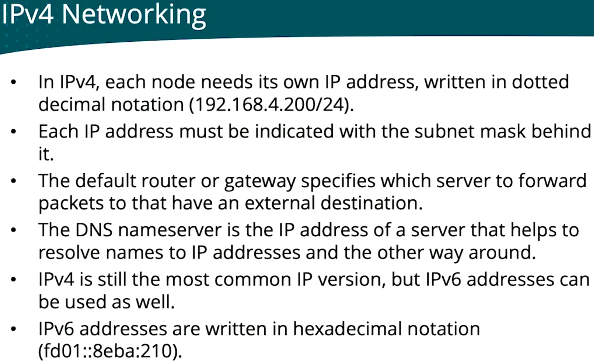
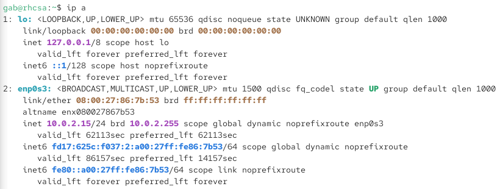
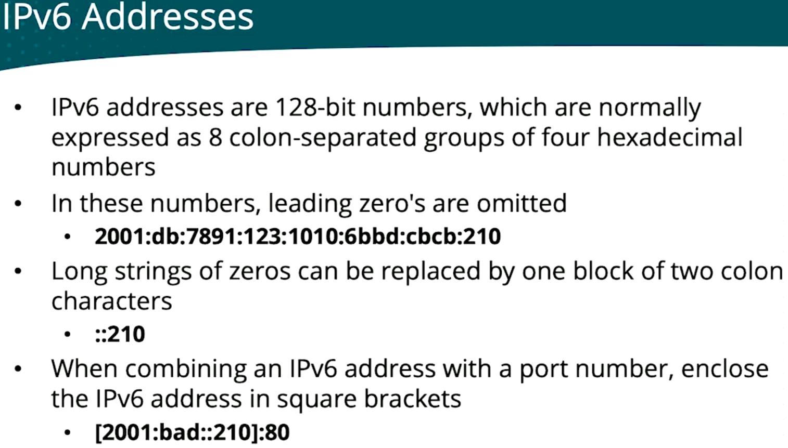
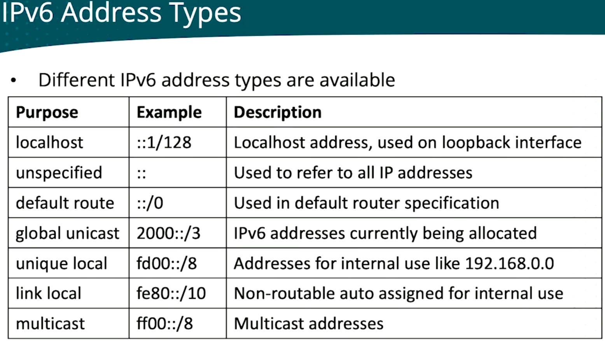
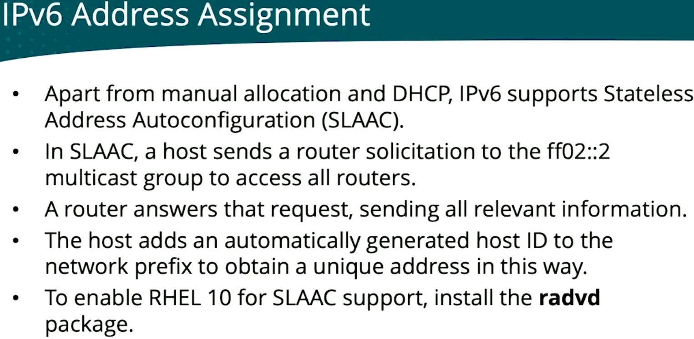
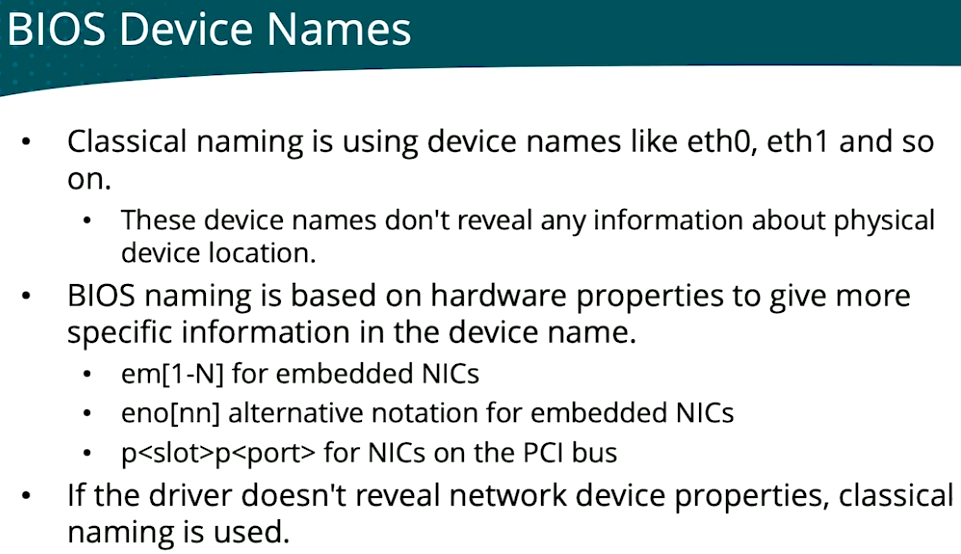
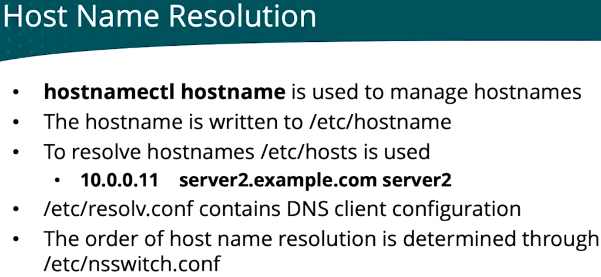

# Day 3

**Course:** [Red Hat RHCSA RHEL 10 with Exam Labs](https://learning.oreilly.com/course/red-hat-rhcsa/9780135493137/) by Sander van Vugt (Pearson, O'Reilly Learning)

## Contents

- [Managing Network Configuration](#managing-network-configuration)
  - [IPv4 networking](#ipv4-networking)
  - [IPv6 addresses](#ipv6-addresses)
  - [IPv6 address assignment](#ipv6-address-assignment)
  - [NIC naming](#nic-naming)
  - [Host name resolution](#host-name-resolution)

---

## Managing Network Configuration

### IPv4 networking



Show the IP addresses of all interfaces:

```bash
ip a
```



- `lo`: the loopback interface, used internally by services that use IP to communicate with one another. There I will always find the IP address `127.0.0.1` (`inet`) and `::1` (`inet6`).
- `enp0s3`: the name of my network device.
  - `altname`: an alternative name for the same device (`enx080027867b53`, based on the MAC address)
  - `inet 10.0.2.15/24`: the most important part, the IPv4 address and subnet mask
  - `dynamic`: the address was given by a DHCP server
  - `link/ether`: MAC address; `inet6 fd17:...`: IPv6 address; `inet6 fe80::...`: link-local IPv6, only valid on the local network
- `ip a` is short for `ip address show`.

### IPv6 addresses



Both shortening rules in my link-local address `fe80::a00:27ff:fe86:7b53`. In full:

```
fe80:0000:0000:0000:0a00:27ff:fe86:7b53
```

- Leading zeros are omitted: `0a00` becomes `a00`.
- A run of all-zero groups becomes `::`: the three `0000` groups disappear.
- Loopback `::1` is the extreme case: `0000:0000:0000:0000:0000:0000:0000:0001`.
- `::` can appear only once per address, otherwise you couldn't tell how many zero groups each one replaces.



My `ip a` output had three of these types:

| Address on my VM | Type |
|------------------|------|
| `::1` | localhost |
| `fe80::a00:27ff:fe86:7b53` | link local (`fe80::/10`) |
| `fd17:625c:f037:2:...` | unique local (`fd00::/8`), VirtualBox's private network, like `10.0.2.x` in IPv4 |

### IPv6 address assignment



### NIC naming



List the PCI devices to see where the NIC is:

```bash
lspci
lspci | grep -i ethernet
```

The network card shows as something like `00:03.0 Ethernet controller: Intel Corporation 82540EM Gigabit Ethernet Controller`. `00:03.0` = PCI bus `00`, slot `03`: that's where `enp0s3` (`p0`, `s3`) gets its name.

### Host name resolution



| Point on the slide | Try it |
|--------------------|--------|
| Set the hostname | `sudo hostnamectl hostname rhcsa.example.com` |
| Written to `/etc/hostname` | `cat /etc/hostname` |
| Resolve names locally | `cat /etc/hosts`. Add a line like `10.0.0.11 server2.example.com server2`, then `ping -c1 server2` |
| DNS client config | `cat /etc/resolv.conf`: shows `nameserver 10.0.2.3` |
| Resolution order | `grep hosts /etc/nsswitch.conf`: shows `hosts: files dns …`, `/etc/hosts` first, then DNS |

On RHEL, NetworkManager writes `/etc/resolv.conf`, so manual edits get overwritten. Set DNS servers with `nmcli` or `nmtui` instead.
